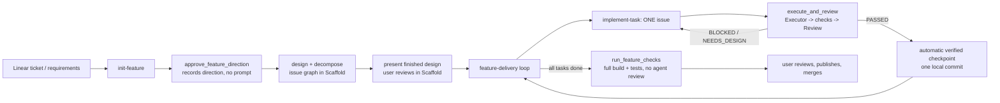

# Pi delivery pipeline: component map

**Status: describes the system after the Scaffold-ledger port (ledger-design.md); the port has merged (#89). Derived from reading the code.** Items marked *(unverified)* were
inferred, not traced. [`workflow-overview.md`](workflow-overview.md) describes
the *process*; this file describes the *parts*, where state lives, and what guards what.
[`src/lib/README.md`](../src/lib/README.md) describes library boundaries in more depth.

## 1. What the system is for

Pi (an LLM agent) implements a feature in small tasks, unattended, on a feature branch.
The system exists so that a human can trust the result without watching. It does that by
enforcing one invariant:

> **Every commit between the feature's baseline and HEAD is an authenticated checkpoint
> of one task that passed its checks and an independent review, under a recorded feature
> direction.**

Almost everything below either *produces* the evidence for that invariant, *checks* it, or
*recovers* when real life breaks it (rebases, interruptions, extra commits).

## 2. Actors

| Actor | What it is | Owns | Trust |
|---|---|---|---|
| **User** | A human | Adoption, amendment and acceptance approvals; merging/publishing; reviewing the finished design | Source of authority. Those approvals are given as an explicit yes in chat and recorded by the approval tools (no dialog). The feature direction itself needs no approval; `init-feature` records it. |
| **Pi** | The LLM orchestrator, driven by `delivery-rules.md` and skills | Reasoning, designs, choosing the next task | **Not trusted.** `delivery-rules.md` tells it to change source only through the native tools; the `delivery-guard` extension enforces that while a delivery is active, and the ledger detects anything that slips past (section 6). |
| **Scaffold** | External CLI that owns the per-feature ledger (`.scaffold/features/…`, gitignored) | Feature + issue graph, designs, task status, `original_baseline`, `workflow.instance_id`, delivery journal | Validates structure and association, **not** evidence authenticity. |
| **Conductor** | External generic command runner | Runs a list of commands with conditions | Neutral runner. |
| **Executor** | External CLI | Applies a set of file operations | Makes the edits. |
| **Review** | External independent reviewer (separate model) | Approves or rejects a diff against the requirements | Independent judge. |
| **Linear** | Ticket system | Ticket source | Input only. |

## 3. Stages, skills and tools



Note the order: the direction is recorded **before** the issue graph is designed, with no
user approval step. The "direction" is the feature-level design context, objective, structured
requirements (stable ids with text and source) and constraints. Issue designs are produced afterwards, inside that recorded scope, and the
user reviews the finished design afterwards. Later departures use `approve_delivery_amendment`, which can never amend a canonical requirement.

Requirement ids flow unchanged from the feature definition to each task's review context
(`requirement:<id>`), to the independent review's per-id assessment, and to the evidence Scaffold
records for the completing attempt. Final validation requires every requirement to be satisfied. See
[`src/tools/execute-and-review/docs/requirement-traceability.md`](../src/tools/execute-and-review/docs/requirement-traceability.md).

| Stage | Skill | Native tool(s) | Code |
|---|---|---|---|
| Prepare feature | `init-feature`, `design` | `scaffold_tasks`, `write_plan`, `linear_*` | `src/tools/scaffold`, `pi/plan`, `pi/linear` |
| Record direction | (in `init-feature`) | `approve_feature_direction` | `src/lib/authorization/feature.mjs` |
| Orchestrate | `feature-delivery` | none of its own | skill text |
| One task | `implement-task`, `executor` | `execute_and_review` | `src/tools/execute-and-review` |
| Checkpoint | (automatic) | `checkpoint_verified_task` (recovery only) | `src/tools/checkpoint` |
| Final gate | `feature-delivery` | `run_feature_checks` | `src/tools/feature-validation` |
| Feature questions (manual) | `feature-questions` | none (read-only) | — |
| Standalone review | `review` | `review_changes` | `src/tools/review` |
| PR vs ticket criteria | `ticket-review` | `review_changes`, GitHub PR tools, Linear read | skill text |

### Every registered tool

| Tool | Extension | Purpose | Mutates |
|---|---|---|---|
| `scaffold_tasks` | scaffold | Scoped read/write of the task graph | Scaffold state |
| `approve_feature_direction` | execute-and-review | Records the feature direction (no prompt) | evidence |
| `approve_delivery_amendment` | execute-and-review | Approve a material contract change | evidence + Scaffold |
| `execute_and_review` | execute-and-review | One Executor, checks, Review pass; auto-completes and checkpoints on PASS | source, evidence, Scaffold, Git |
| `checkpoint_verified_task` | checkpoint | Create or recover the checkpoint commit for a passed task | Git |
| `run_feature_checks` | feature-validation | Final full build/test checks, no agent review; the gate `feature-delivery` uses. Records `checked` (never `verified`) in Scaffold | evidence, Scaffold |
| `accept_feature` | feature-validation | The user's sign-off on the current `checked`/`verified` result (the user's explicit chat yes, no dialog); judged from the ledger alone. Never called by a skill on its own | evidence, Scaffold |
| `validate_feature` | feature-validation | Full checks + whole-feature agent review, recorded in Scaffold. Not called by any skill; kept available | evidence, Scaffold |
| `inspect_conductor_evidence`, `inspect_feature_validation`, `inspect_issue_handoff`, `inspect_issue_attempt` | various | Read retained evidence and handoffs | none |
| `suspend_issue`, `resume_issue` | execution-recovery | Park an unfinished issue (saved source/index) and return the graph to design; restore it later | Scaffold, refs, evidence |
| `prepare_issue_handoff` | execution-recovery | Save scoped context for a fresh session | evidence |
| `rewrite_feature_history` | execution-recovery | After a user rebase between tasks: map the recorded history onto the rebased commits, re-verify, record a `history-rewrite` | ledger |
| `adopt_foreign_commits` | execution-recovery | Record user commits that are not task checkpoints (`history-foreign`), between tasks | ledger |
| `rebind_requirement_evidence` | execution-recovery | After a corrective issue changed a requirement's contributors or verifiers: re-record stale evidence whose own review verified it | ledger |
| `inspect_feature_drift` | execution-recovery | Read-only: classify Git drift, name the recovery (PR #87) | none |
| `review_changes` | review | Standalone review | none |
| `write_plan`, `write_ticket_file` | plan | Write planning documents | files |
| `linear_*` (4) | linear | Ticket API | Linear |

`delivery-guard` registers no tool: it is a `tool_call` handler that blocks direct edits and unsafe shell commands
while a delivery is active (`src/lib/guard/`, `pi/delivery-guard/`).

Also in the repo but unrelated to delivery: the `lsp` and `conductor` (`/conductor` command)
extensions, and the `comfyui-generate` skill.

## 4. Where state lives

**One ledger per feature instance, owned by Scaffold.** Pi never reads Scaffold's files; it reads and writes
only through the Scaffold CLI. See [`ledger-design.md`](ledger-design.md) for the design and its rationale.

```
.scaffold/                       ignored and untracked; Pi refuses to run if it is visible to Git
  features/<feature>.<instance>/
    ledger.jsonl                 append-only, hash-chained: every action, its payload and its state change
    artifacts/<sha256>           receipts, approvals, verifications, suspensions (content-addressed JSON)
  work/                          scratch: Conductor runs, boundaries, finalization, handoffs (not evidence)
```

| What | Where it lives | Written by |
|---|---|---|
| Feature, issue graph, designs, task status | the ledger (folded state) | Scaffold |
| Direction record | `direction-approve` entry | Scaffold, written by `approve_feature_direction` (no UI confirmation) |
| Task receipts | artifact, cited by an `attempt-record` entry | Pi stores it, Scaffold records the attempt |
| Completion, checkpoints | `complete` and `checkpoint-record` entries | Scaffold, after Pi verifies Git |
| Recorded history from base to head | `history` / `head` / `base` / `epochs` in the folded state | Scaffold (`checkpoint-record`, `history-foreign`, `history-rewrite`) |
| Feature validation results | `validation-*` entries; the full record is an artifact | Scaffold and Pi |
| Failures | `failure-record` entry; the last 20 in `failures` in the folded state | Pi (every delivery tool), via Scaffold |
| The checkpoint commits themselves | Git; trailer `Pi-Checkpoint: <task>` | Pi |

Scaffold enforces the rules between these (a completion must cite a recorded PASSED attempt; a checkpoint must
continue from the recorded head; `start` needs a matching approval; validation needs the recorded head). Pi
confirms everything that needs Git, the Executor or the reviewer before appending.

**Failure reporting.** Every delivery tool (execute, checkpoint, validate, recovery, `scaffold_tasks`) is wrapped by
`src/lib/failure/tool.mjs`. A failure, whatever shape the tool returned it in, gains one `failure` object: `code`,
`message`, `cause`, `stage`, `evidence`, `owner` and `next`. `owner` says who acts: `agent` (fix and retry),
`user` (a decision or repair outside the agent's reach) or `bug` (the pipeline itself failed). `next` comes from the
one code-to-remedy table, `src/lib/failure/codes.mjs`, and a test fails if the pipeline emits a code that is not in it.
An exception a tool did not handle becomes an `INTERNAL_ERROR` failure with its cause, not a bare error. Failures that
leave no receipt are appended to the ledger (`failure-record`) so a person can see how a run went wrong; a
`NEEDS_DESIGN` attempt already has its receipt and is not logged twice. Recording is best effort and never replaces
the failure it describes.

**What is still outside the ledger.** A few Git refs keep saved source reachable so garbage collection cannot lose
it: `refs/pi-issue-suspensions/` (parked source), `refs/pi-task-recoveries/` (before/after trees of a handoff chain),
`refs/pi-checkpoints/` (a checkpoint commit in flight) and `refs/pi-delivery-journals/` (journal audit anchors).
They hold Git objects, not records. Replacing them with ledger artifacts is future work.

**Limits.** The chain makes edits to history detectable; it does not stop a process with write access from
appending a forged entry, and it cannot detect removal of the newest whole entries. The ledger is per checkout.

## 5. Code layers

```
skills/ + delivery-rules.md         guidance for Pi (text; no enforcement)
pi/delivery-mcp/index.ts     registers the MCP server with Pi
src/lib/host/pi.mjs          the Pi seam: MCP server discovery and the guard's tool_call handler
src/tools/*/tools.mjs       host-neutral tool definitions: schema + execute(params, host)
src/tools/*/*.mjs           workflows: coordinate, perform lifecycle writes
src/lib/host/tool.mjs      neutral tool contract, toolResult, failure-envelope wrapper
src/lib/verification         authenticate evidence, chains, checkpoints (pure checks)
src/lib/authorization        feature/amendment authority
src/lib/evidence, scaffold, git  ledger artifact client, Scaffold CLI client, Git snapshots, contracts
external: Scaffold, Conductor, Executor, Review
```

Rule (from `src/lib/README.md`): **`src/lib` never imports from `src/tools` or `pi`.** Coordinators fetch fresh
Scaffold data and pass it in; libraries validate it.

**Host neutrality.** A tool is `{ name, label, description, parameters, execute(params, host) }` with
`host = { cwd, signal, onUpdate }` (`src/lib/host/tool.mjs`). There is no dialog channel: approvals are given in chat. No `.mjs` module may import a host SDK or touch `ctx.ui`; a test
enforces this, so a second host (for example an MCP server) can load `tools.mjs` unchanged and write only
its own adapter beside `src/lib/host/pi.mjs`. That second adapter now exists: `src/lib/host/mcp.mjs` plus the server in
`mcp/` (see its README, including what it does not yet enforce). Pi uses that server as the only transport for its delivery tools (the `delivery-mcp` extension), approval tools included. Schemas are built with an injected TypeBox-style `Type`.
**Enforcement versus detection.** Three layers keep the orchestrator honest, and they differ in kind:
instructions (`delivery-rules.md`, skills: no enforcement), a guard that *prevents* (`src/lib/guard/`, applied in Pi by the
`delivery-guard` extension's `tool_call` handler and in Claude Code by the plugin's `PreToolUse` hook), and the ledger
that *detects* (every host, section 6).
Pi-only by design: `/conductor` and `/implement-next` (slash commands that drive the UI or replace the
session), and `plan` and `linear` (not yet converted; they overlap host file and Linear tools).

## 6. Where the invariant is enforced

`checkpointHistory()` (`src/lib/verification/checkpoint-history.mjs`) walks HEAD back to the
baseline and requires each commit to be an authentic checkpoint matching a completed task
and its receipt. It is called from:

`issue-scope` (before executing a task), `attempt-chain` (continuations), `checkpoint/commit.mjs`
(creating a checkpoint), `feature-validation` (final gate), `src/lib/verification/reconciliation.mjs`
and `execution-recovery/reconciliation.mjs` (rebase), `issue-recovery`, and `drift.mjs`.

Any new situation in which history legitimately contains something that is not a checkpoint
needs its own accommodation here. That is the source of most special cases.

## 7. Authority

| Grant | Granted by | Lasts | Covers |
|---|---|---|---|
| Feature direction | `approve_feature_direction` (recorded by `init-feature`, no UI confirm) | A `direction-approve` ledger entry; Scaffold computes and matches the scope digest | The whole local loop: design, implementation, checks, review, checkpoints, recovery. **Not** publish or merge. |
| Delivery amendment | `approve_delivery_amendment` | Per change | One concrete contract change |
| Foreign commits | `adopt_foreign_commits` (chat approval) | Recorded in the ledger | One named recorded head to new head range |
| Feature acceptance | `accept_feature` (chat approval) | A `validation-accept` ledger entry; ends at any later graph or history change, invalidation or new validation | The user's sign-off on one validated head. Grants nothing else: not publish, merge or change |
| Checkpoint grant | per-session UI grant (`checkpointAuthorization`) | Session | Local commits; separate from feature direction |

## 8. Recovery: which tool, when

| Situation | Use |
|---|---|
| Not sure | `inspect_feature_drift` |
| Clean user commits between tasks | `adopt_foreign_commits` |
| You rebased between tasks | `rewrite_feature_history` |
| You rebased while a task was active | `suspend_issue`, `rewrite_feature_history`, `resume_issue` |
| Final checks blocked on stale requirement evidence after a corrective issue | `rebind_requirement_evidence` |
| A task failed or was interrupted | continue with `previousAttempt` / issue handoff |
| Checkpoint commit lost or interrupted | repeat `checkpoint_verified_task` |
| Need to park an issue and return to design | `suspend_issue`, then `resume_issue` |
| Never | edit the ledger by hand; run `scaffold clean` as a recovery step (it only closes a feature now); reapprove to reset history |

## 9. Glossary

- **Original baseline**: commit the feature branched from; recorded in Scaffold; immutable.
- **Execution baseline**: where checkpoints begin. Equals the original baseline unless adopted.
- **Instance id**: `workflow.instance_id`; distinguishes a recreated feature from the original.
- **Receipt**: content-addressed evidence of one task attempt (checks + review).
- **Checkpoint**: the local commit produced for a passed task, carrying provenance in a trailer.
- **Anchor**: a verified point that lets history checks start later than the baseline (rebase reconciliation).
- **Adoption**: user-approved move of the execution baseline over unverified commits. They stay in review scope.
- **Handoff / suspension**: saved context or source so work can resume in a fresh session or after a design change.
- **Reconciliation**: verification-only recovery after a rebase.

## 10. Known gaps in this map

- Saved source for suspended issues and handoffs is still pinned with the four `refs/pi-*` families (section 4).
- Suspension with *consumed attempts* (dirty source saved and restored) is exercised by the older stub-based tests,
  not yet by a real-Scaffold test; the zero-attempt path is.
- Not traced: the internals of Scaffold's design-phase rules, Conductor, Executor and Review.
